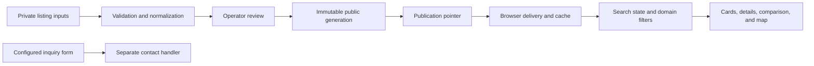

# Architecture

## Application and services

The frontend is a Next.js static export: HTML, CSS, and browser JavaScript.
There are no Next.js API routes or server actions. The browser reads sanitized
listing generations and, only when explicitly configured, calls separate
inquiry or unsubscribe APIs. AWS ingestion and publication services are
separate from the web application.

The diagram describes the implementation's responsibilities. Local builds and
tests do not connect to an MLS feed, provision AWS, or submit live inquiries.
Production configuration and third-party service permissions are independent
of the source.

## Boundaries in the code

| Responsibility | Location | Boundary |
| --- | --- | --- |
| Routes, metadata, layout | `src/app/` | Compose content and feature entry points. |
| Listing types, validation and search | `src/lib/` | Pure domain logic and explicit data loading. |
| Residential search coordination | `src/features/properties/PropertiesSearch.tsx` | Compose search, history, map and selection state. |
| Residential views and lifecycle hooks | `src/features/properties/search/` | Separate delivery, persistence, price state and focused views. |
| Map integration | `src/features/properties/map/` | Isolate the Maps SDK, coordinate delivery, marker rendering and cancellation. |
| Commercial search | `src/features/commercial/` | Compose commercial filters, result cards and accessible controls. |
| Geocode event validation | `scripts/geocode/audit-events.mjs` | Pure metadata schema and redaction rules; no listing-data import or I/O. |
| Geocode audit persistence | `scripts/geocode/audit-storage.mjs` | Explicit durable ledger, immutable mirror and run-lock adapters. |
| Enrichment orchestration | `scripts/enrich-mls-coordinates.mjs` | Plans and executes enrichment with injected provider/checkpoint/audit boundaries. |
| Serverless functions | `infrastructure/mls-ingestion/handlers/` | Authenticate operators and handle upload, run, publication and contact requests. |

Feature-local modules belong with their feature. Shared domain behavior belongs
in `src/lib` only when there are real independent consumers. Avoid moving
feature state into a generic utility or service framework just to reduce file
length.

## Browser state and asynchronous work

Search URLs and browser history describe navigable state. Saved homes, search
preferences and snapshots use local browser storage; persistence is best
effort and must not make the page unusable when storage is unavailable.
Stored values are untrusted input and are normalized before use.

Listing manifests and details are loaded separately. The delivery layer owns
generation-aware cache invalidation and request reuse. Views observe those
requests without making a loading-state update cancel the request that caused
it. Failed or invalid details must be eligible for explicit retry.

Maps own external SDK objects whose lifetime differs from React render
objects. Marker batches are keyed by the data that changes their meaning;
recreating an equivalent array must not abandon half a batch. Cleanup must
cancel obsolete work and detach listeners/markers. Pure marker planning and
imperative SDK adaptation should remain separate.

Price slider bounds describe a search domain. Moving a thumb must not redefine
that domain; restoring a different historical search must update it. Regression
tests should express those user actions, not just assert dependency arrays.

## Publication and audit flow

Listing processing separates parsing, compliance checks, reviewed overrides,
coordinate provenance and generation output. Publication uses immutable
generations and an explicit current pointer. UI availability is based on
published data; missing inventory is not filled with invented live listings.

Geocoding runs persist redacted request-start evidence before the paid request
and record its outcome afterward. The event schema rejects result coordinates,
addresses, keys and arbitrary provider error text. Persistence adapters handle
fsync, serialized appends, conditional mirror writes and exclusive run locks.
Archiving depends on the event schema rather than loading the enrichment CLI
or private listing overrides.

The enrichment entry point preserves its existing exported functions for
operational callers. Splitting a module is not authorization to change paid
request limits, retention rules, publication approval or cloud permissions.

## Source edition

The source edition is a history-free package assembled separately from the
private production repository. It excludes listing records, private overrides
and caches, client guides, original restricted images and production operator
workflows. Labeled placeholders preserve image dimensions; geographic data
and fonts retain their own notices.

The source edition runs the full app locally. Its default inquiry, unsubscribe,
map and operator configurations have no production credentials or endpoints.
The private repository's maintenance setting is independent of that edition.

## Validation and remaining size

Use the root README for executable commands. Validation includes domain and
component tests, infrastructure tests, static checks, full-app compilation,
preview-server tests and isolated browser smoke and responsive tests using
invented records, including narrow viewports and enlarged text.
Fixture tests exercise local behavior, not a production deployment or provider
agreement.

Residential search still coordinates substantial product behavior, and the
enrichment entry point still owns planning, cache recovery and execution.
Further extraction should follow a concrete change or failure mode, with
behavior tests at the boundary. Small files are useful when their contracts are
clear; size alone is not a quality metric.
